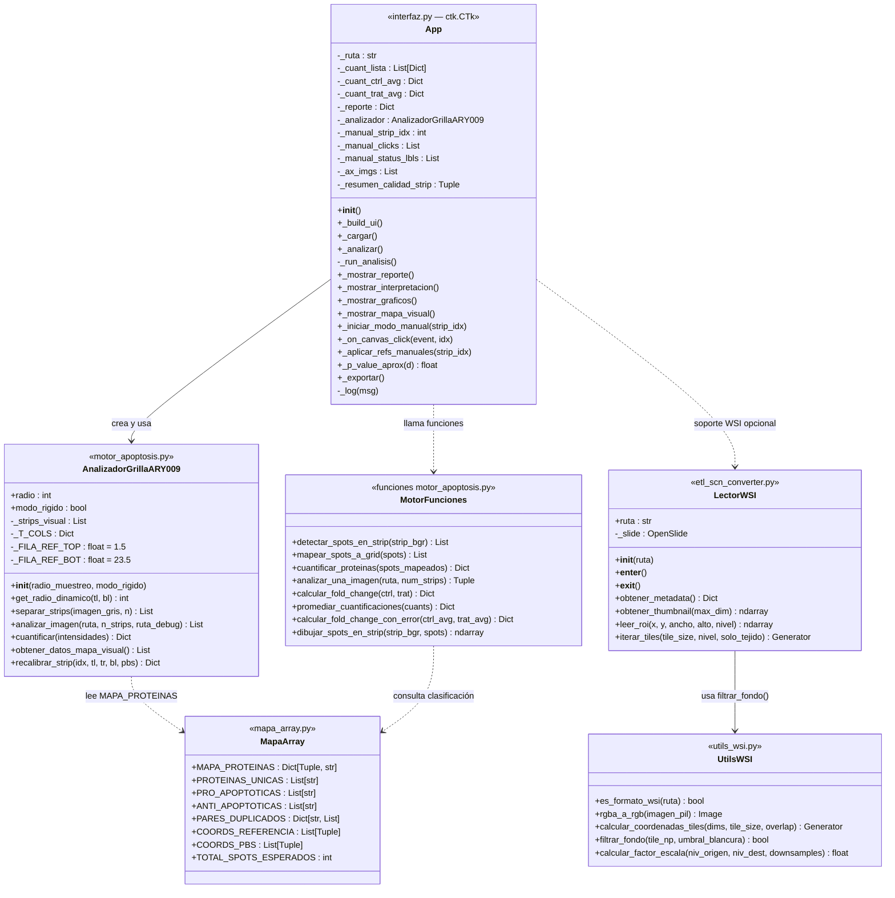
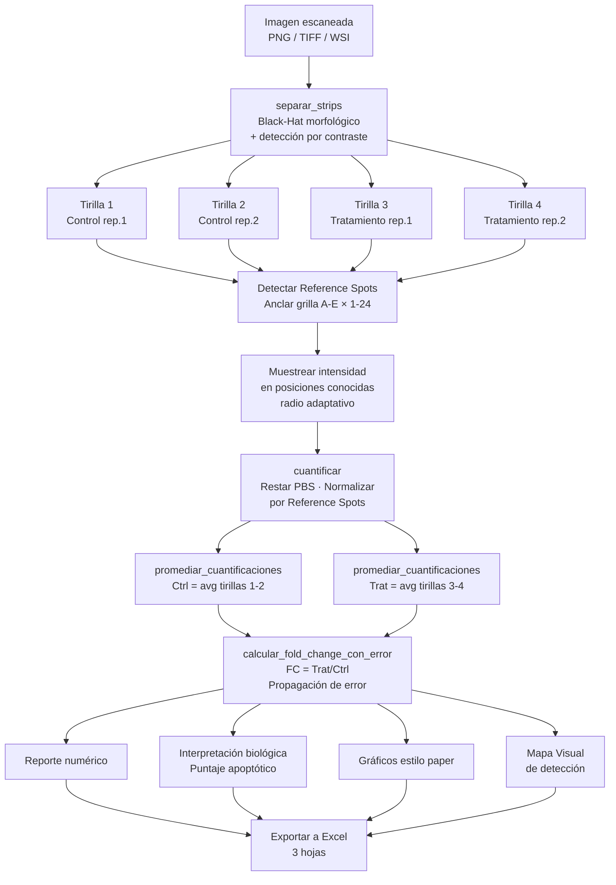

# Analizador Proteome Profiler ARY009

**Semillero de Investigación Biomédica — Detección de Cáncer**
Instituto Tecnológico Metropolitano (ITM) · Colombia · 2026

---

## Descripción

Pipeline automatizado para el análisis cuantitativo de membranas del **Proteome Profiler Human Apoptosis Array Kit (ARY009)** de R&D Systems. El sistema detecta, cuantifica y compara la expresión de **35 proteínas relacionadas con apoptosis** entre condiciones de control y tratamiento, produciendo reportes numéricos, gráficos estilo paper y exportación a Excel.

---

## Novedades (octubre 2026)

Ronda de mejoras enfocada en que los resultados sean **más precisos y más honestos**. Medido sobre las 6 membranas de prueba (24 tirillas):

| Indicador | Antes | Ahora |
|---|---|---|
| Tirillas con datos | 16 / 24 | **23 / 24** |
| Tirillas separadas correctamente | 21 / 24 | **24 / 24** |
| Cuadros con mancha descentrados | 25 % | **10 %** |
| Diferencia típica entre duplicados de una proteína | 7,8 % | **6,9 %** |
| Cuadros midiendo la proteína vecina | >100 | **0** |

**Cambios principales**

- **Lectura directa de `.scn` (Bio-Rad ChemiDoc) en 16 bits.** Antes la conversión a PNG dividía entre 256 y se perdía precisión de intensidad; ahora `convertir_scn.py` conserva los 16 bits y el motor abre el `.scn` sin pasos manuales.
- **Duplicados honestos.** Cuando los dos puntos de una proteína no coinciden, ya no se toma el mayor (sesgaba hacia arriba): se promedian, como indica el kit, y la proteína se marca como *baja confianza*.
- **Alertas de saturación.** Se detectan los spots saturados del escáner; si el saturado es un Reference Spot, se avisa que la normalización de toda la tirilla no es confiable.
- **Hoja "Alertas de calidad" en el Excel**, con una explicación simple de cada alerta.
- **Separación de tirillas y anclaje corregidos** (recortes con ancho negativo y ancla inferior fuera del par de referencia).
- **Centrado de cuadros:** centrado fino sobre cada mancha, protección contra cuadros encimados y un *límite de celda* que impide que un cuadro sin señal se desplace hasta la mancha de la proteína vecina.
- **Pruebas automáticas** (`tests/`) para medir cada cambio con números y evitar retrocesos.

---

## ¿Qué hace?

1. **Carga** una imagen escaneada con 4 tirillas de membrana: `.scn` de Bio-Rad ChemiDoc (recomendado, 16 bits), PNG, TIFF o WSI.
2. **Separa** las tirillas automáticamente usando detección morfológica (Black-Hat + contraste).
3. **Detecta** los Reference Spots para anclar una grilla geométrica de 5 columnas × 24 filas.
4. **Muestrea** la intensidad en cada posición conocida del kit con radio adaptativo.
5. **Cuantifica**: resta fondo PBS, normaliza por Reference Spots, promedia réplicas internas.
6. **Calcula** Fold Change con propagación de error entre Control (tirillas 1-2) y Tratamiento (tirillas 3-4).
7. **Interpreta** los resultados con un puntaje apoptótico y explicaciones en español accesibles.
8. **Exporta** a Excel con cuatro hojas: Fold Change, Intensidades Brutas, Intensidades Normalizadas y Alertas de calidad.

---

## Arquitectura del Sistema

El proyecto está organizado en cuatro módulos principales con responsabilidades bien separadas:

```
interfaz.py          ← GUI (CustomTkinter + Matplotlib)
    │
    ├── motor_apoptosis.py  ← Lógica de análisis: detección, grilla, cuantificación
    │       └── mapa_array.py  ← Datos del kit: mapa proteínas ↔ coordenadas
    │
    └── (opcional) utils_wsi.py / etl_scn_converter.py  ← Soporte WSI
```

---

## Diagrama de Clases UML



---

## Flujo del Pipeline de Análisis



---

## Descripción de Módulos

### `mapa_array.py`

Fuente de verdad del layout físico del kit ARY009. Contiene el mapeo completo de coordenadas de grilla a nombre de proteína, además de las clasificaciones biológicas.

| Constante | Descripción |
|-----------|-------------|
| `MAPA_PROTEINAS` | Dict `(col, fila) → nombre_proteína` para las 78 posiciones del kit |
| `PROTEINAS_UNICAS` | Lista ordenada de las 35 proteínas (sin Reference ni PBS) |
| `PRO_APOPTOTICAS` | 16 proteínas que activan la muerte celular |
| `ANTI_APOPTOTICAS` | 18 proteínas que bloquean la muerte celular |
| `PARES_DUPLICADOS` | Cada proteína tiene 2 réplicas internas (duplicados) en la membrana |
| `COORDS_REFERENCIA` | 6 posiciones de Reference Spots en esquinas A1, A2, A23, A24, E1, E2 |
| `COORDS_PBS` | 2 posiciones PBS (control negativo): D23, D24 |

---

### `motor_apoptosis.py`

Motor de análisis de imagen. Contiene la clase principal y las funciones del pipeline.

#### Clase `AnalizadorGrillaARY009`

Analizador basado en grilla fija con ancla en Reference Spots. Es más robusto que la detección libre de spots porque muestrea directamente en posiciones conocidas, sin depender de que todos los spots sean visibles.

| Método | Descripción |
|--------|-------------|
| `separar_strips(imagen_gris, n)` | Divide la imagen en N tirillas verticales usando brillo o Black-Hat |
| `analizar_imagen(ruta, n_strips)` | Pipeline completo: carga → separa → detecta referencias → muestrea |
| `cuantificar(intensidades)` | Resta PBS, normaliza por Reference, clasifica proteínas |
| `get_radio_dinamico(tl, bl)` | Calcula radio de muestreo adaptativo según distancia real entre filas |
| `obtener_datos_mapa_visual()` | Devuelve datos para renderizar el Mapa Visual en la GUI |
| `recalibrar_strip(idx, tl, tr, bl, pbs)` | Reaplica la grilla con referencias marcadas manualmente por el usuario |

#### Funciones independientes

| Función | Descripción |
|---------|-------------|
| `detectar_spots_en_strip(strip)` | Detección morfológica Black-Hat de manchas oscuras |
| `mapear_spots_a_grid(spots)` | Asigna cada spot detectado a una coordenada de grilla |
| `cuantificar_proteinas(spots)` | Promedia duplicados, resta PBS, normaliza |
| `promediar_cuantificaciones(cuants)` | Promedia N réplicas y calcula desviación estándar |
| `calcular_fold_change(ctrl, trat)` | Fold Change simple: `FC = Trat / Ctrl` |
| `calcular_fold_change_con_error(ctrl_avg, trat_avg)` | FC con propagación de error: `σ_FC/FC = √((σT/T)²+(σC/C)²)` |
| `dibujar_spots_en_strip(strip, spots)` | Dibuja bounding boxes de diagnóstico sobre la imagen |

---

### `interfaz.py`

GUI construida con **CustomTkinter** (tema oscuro) y **Matplotlib** (gráficos embebidos). Toda la comunicación con el motor ocurre en un hilo separado para no bloquear la interfaz.

#### Clase `App(ctk.CTk)`

| Sección | Widgets / Métodos |
|---------|-------------------|
| Barra superior | `btn_cargar`, `lbl_archivo`, aviso del esquema ARY009 |
| Control de análisis | `btn_analizar`, `chk_rigido` (modo geométrico puro) |
| **Tab 1: Reporte** | `textbox` — tabla numérica con valores individuales y promediados |
| **Tab 2: Interpretación** | `txt_interp` — veredicto apoptótico, hallazgos clave, balance Bax/Bcl-2 |
| **Tab 3: Gráficos** | Canvas Matplotlib — Panel A: pro-apoptóticas, Panel C: anti-apoptóticas |
| **Tab 4: Mapa Visual** | Sub-tabs por tirilla con imagen real + cuadros de muestreo superpuestos |
| Exportar | `btn_export` → `_exportar()` genera archivo `.xlsx` |
| Modo manual | `_iniciar_modo_manual()` / `_on_canvas_click()` / `_aplicar_refs_manuales()` |

---

### `utils_wsi.py`

Utilidades para Whole Slide Images (escáneres de patología digital).

| Función | Descripción |
|---------|-------------|
| `es_formato_wsi(ruta)` | Detecta si el archivo requiere OpenSlide (`.scn`, `.svs`, `.ndpi`, TIFF piramidal) |
| `rgba_a_rgb(imagen_pil)` | Convierte RGBA → RGB (OpenSlide retorna imágenes con canal alpha) |
| `calcular_coordenadas_tiles(dims, tile_size, overlap)` | Generador de coordenadas para recorrido en tiles con overlap opcional |
| `filtrar_fondo(tile_np, umbral_blancura)` | Descarta tiles que son fondo blanco (> 85% píxeles blancos por defecto) |
| `calcular_factor_escala(niv_orig, niv_dest, downsamples)` | Factor para convertir coordenadas entre niveles piramidales |

---

### `etl_scn_converter.py`

Pipeline ETL de línea de comandos para conversión masiva de archivos `.scn` (Leica) a tiles TIFF/PNG.

#### Clase `LectorWSI`

Context manager que encapsula `openslide.OpenSlide`. Soporta lectura de metadatos, thumbnails, ROIs y generación de tiles con filtrado de fondo.

**Modos de operación CLI:**

```bash
# Conversión a tiles TIFF de 512×512
python etl_scn_converter.py --input ./datos --output ./tiles

# Solo thumbnails de vista previa
python etl_scn_converter.py --input ./datos --output ./previews --thumbnail-only

# Extraer ROI específico (x, y, ancho, alto)
python etl_scn_converter.py --input ./datos --output ./rois --roi 1000,2000,1024,1024

# Procesamiento paralelo con 4 hilos
python etl_scn_converter.py --input ./datos --output ./tiles --workers 4
```

---

## Esquema del Kit ARY009

```
Imagen escaneada (4 tirillas horizontales)
┌─────────────────────────────────────────────────────┐
│  [Tirilla 1 — Control rep. 1]                       │
│  [Tirilla 2 — Control rep. 2]                       │
│  [Tirilla 3 — Tratamiento rep. 1]                   │
│  [Tirilla 4 — Tratamiento rep. 2]                   │
└─────────────────────────────────────────────────────┘

Cada tirilla — Grilla 5 columnas × 24 filas:
  Col A: Reference Spots (esquina der. sup e inf)
  Col B: Bad, Bax, Bcl-2, Bcl-x, Caspasas, Catalase, cIAPs, Claspin, Clusterin, Cytochrome c
  Col C: TRAIL R1/R2, FADD, Fas, HIF-1a, HO-1/2, HSP27/60/70, HTRA2, Livin
  Col D: PON2, p21, p27, Phospho-p53 (×3), Phospho-Rad17, SMAC/Diablo, Survivin, TNF RI, XIAP
  Col E: Reference Spots (esquina izq. sup)
  D23-D24: PBS (control negativo / fondo)

Cada proteína aparece 2 veces (filas pares e impares) como réplica interna.
```

| Categoría | Proteínas representativas |
|-----------|--------------------------|
| **Pro-apoptóticas** (activan muerte) | Bax, Bad, Cytochrome c, Cleaved Caspase-3, SMAC/Diablo, TRAIL R1/R2, Phospho-p53, FADD |
| **Anti-apoptóticas** (bloquean muerte) | Bcl-2, Bcl-x, Survivin, XIAP, cIAP-1/2, Livin, HSP27/60/70, Clusterin |
| **Control interno** | Reference Spots (normalización), PBS (fondo) |

---

## Cuantificación y Estadística

### Normalización por Reference Spots

```
Intensidad_neta    = Intensidad_bruta − PBS
Intensidad_norm    = Intensidad_neta / (Reference − PBS)
```

### Fold Change con propagación de error

```
FC = Trat_norm / Ctrl_norm

Error relativo:
σ_FC / FC = √( (σ_Trat / Trat)² + (σ_Ctrl / Ctrl)² )
```

### Clasificación del resultado

| Fold Change | Estado |
|-------------|--------|
| `> 1.5` | **▲ AUMENTÓ** |
| `0.67 – 1.5` | **─ SIN CAMBIO** |
| `< 0.67` | **▼ DISMINUYÓ** |
| `Ctrl ≈ 0, Trat > 0` | **▲ APARECIÓ** |
| `Ctrl > 0, Trat ≈ 0` | **▼ DESAPARECIÓ** |

### Puntaje apoptótico

```
Score = (pro↑ + pro_aparece + anti↓ + anti_desaparece)
      − (pro↓ + pro_desaparece + anti↑ + anti_aparece)

Score ≥ +5 → Inducción de apoptosis probable
Score ≥ +2 → Tendencia pro-apoptótica
Score ≤ −5 → Resistencia / supervivencia dominante
```

---

## Estructura del Proyecto

| Archivo | Rol |
|---------|-----|
| [interfaz.py](interfaz.py) | GUI principal (CustomTkinter + Matplotlib) |
| [motor_apoptosis.py](motor_apoptosis.py) | Motor: detección, grilla, cuantificación, fold change |
| [mapa_array.py](mapa_array.py) | Mapa oficial ARY009: proteínas ↔ coordenadas de grilla y posición de columnas (`T_COLS`) |
| [gridfit_ary009.py](gridfit_ary009.py) | Ajuste rígido de la grilla completa contra los spots detectados (último recurso de anclaje) |
| [convertir_scn.py](convertir_scn.py) | Lector de `.scn` Bio-Rad en 16 bits y conversión a PNG de 16 bits |
| [tests/regresion.py](tests/regresion.py) | Prueba de regresión: tirillas separadas y con datos en las 6 membranas |
| [tests/metricas_centrado.py](tests/metricas_centrado.py) | Métricas de centrado: descentrados, encimados, proteína vecina, diferencia entre duplicados |
| [utils_wsi.py](utils_wsi.py) | Utilidades para Whole Slide Images (OpenSlide) |
| [etl_scn_converter.py](etl_scn_converter.py) | CLI de conversión masiva .SCN → TIFF/PNG |
| [generar_mapa_ary009.py](generar_mapa_ary009.py) | Genera la imagen de referencia visual del kit |
| [mapa_referencia_ary009.png](mapa_referencia_ary009.png) | Imagen estática del layout del kit (pestaña Guía) |
| [requirements.txt](requirements.txt) | Dependencias del proyecto |

---

## Instalación y Uso

### Requisitos

```bash
pip install opencv-python numpy matplotlib customtkinter Pillow openpyxl
```

Los `.scn` de **Bio-Rad ChemiDoc** se leen sin dependencias adicionales.

**Opcional** (solo para Whole Slide Images de microscopio: `.svs`, `.ndpi`, `.scn` de Leica):

```bash
pip install openslide-python openslide-bin
```

### Ejecutar

```bash
python interfaz.py
```

### Pasos en la interfaz

1. Click en **"Cargar imagen del escáner"** → selecciona el archivo **`.scn` original** del ChemiDoc (recomendado) o un PNG/TIFF. Evita PNG exportados en 8 bits o de origen desconocido: pierden precisión y algunos están dañados.
2. Click en **"Analizar Membranas"**.
3. Revisa los resultados en las 4 pestañas:
   - **Reporte**: tabla numérica con valores individuales por tirilla y promedios.
   - **Interpretación**: veredicto apoptótico, resumen por categoría, hallazgos clave.
   - **Gráficos**: barras horizontales estilo paper con barras de error.
   - **Mapa Visual**: imagen real con cuadros de muestreo superpuestos + Guía del kit.
4. Si alguna tirilla falla la detección automática → click en **"Ajustar referencias manualmente"** y haz 4 clicks sobre los Reference Spots reales.
5. Exporta a Excel con el botón inferior.

---

## Salida Excel

El archivo `.xlsx` generado contiene cuatro hojas:

| Hoja | Contenido |
|------|-----------|
| **Fold Change** | Proteína, tipo, Control ± desv., Tratamiento ± desv., FC ± error, p aproximado, estado |
| **Intensidades brutas** | Valor bruto por proteína para cada una de las 4 tirillas |
| **Intensidades normalizadas** | Valor normalizado por proteína para cada una de las 4 tirillas |
| **Alertas de calidad** | Por tirilla: referencias saturadas, spots saturados, duplicados discordantes (baja confianza), tirillas sin referencias o recalibradas a mano |

---

## Pruebas

Desde la raíz del proyecto (con las imágenes `.scn` en `fotos/`):

```bash
python tests/regresion.py          # tirillas separadas y con datos
python tests/metricas_centrado.py  # calidad del centrado de la grilla
```

Cualquier cambio al motor debe mantener o mejorar estas métricas.

---

## Limitaciones conocidas

- **Resolución:** las imágenes del ChemiDoc miden 348×260 px; cada spot ocupa 2-3 píxeles reales, lo que limita la precisión del centrado. Exportar a mayor resolución (sin *binning*) mejoraría los resultados.
- **Saturación:** en varias membranas de prueba los Reference Spots están saturados; esas tirillas se marcan en la hoja de alertas porque su normalización no es del todo confiable. Se recomiendan exposiciones más cortas.
- **Membranas tenues:** C.mama-Cúrcuma tirilla 4 no se puede anclar (señal muy débil); se deja vacía en lugar de entregar datos falsos.
- **Geometría del kit:** las posiciones de columna medidas en las membranas reales difieren ligeramente de `T_COLS` (B ≈ 0,25 vs 0,21; D ≈ 0,58 vs 0,64). Corregirlo es el siguiente paso pendiente.

---

## Consideraciones estadísticas

> Con solo 2 réplicas internas por condición (tirillas 1-2 vs 3-4), los p-valores reportados son **estimaciones indicativas** con muy bajo poder estadístico (df ≈ 2). No deben usarse como criterio definitivo. Para significancia estadística real se necesitan mínimo 3 réplicas biológicas independientes, confirmadas con Western blot.

---

## Autores

**Semillero de Investigación Biomédica — ITM, 2026**
Instituto Tecnológico Metropolitano · Medellín, Colombia
